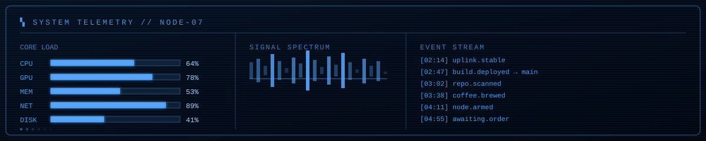

<div align="center">



</div>

<br>

<div align="center">

```text
  ┌───────────────────────────────────────────────────────────────┐
  │  W A R N I N G   T H I S   R E P O   S U P E R V I S E S      │
  │  P R O F I L E   T E R M I N A L   ·   v 2 . 0 7 7            │
  └───────────────────────────────────────────────────────────────┘
```

</div>

<div align="center">



</div>

<div align="center">

### `> 接入终端 ... 已建立安全信道`

**[YOUR_NAME](https://github.com/YOUR_HANDLE)** · `YOUR_TITLE` · 🌐 `Remote-First` · ⚡ `Always Building`

<br>

<a href="https://github.com/YOUR_HANDLE"></a>
<a href="https://linkedin.com/in/YOUR_HANDLE"></a>
<a href="https://twitter.com/YOUR_HANDLE"></a>
<a href="https://YOUR_HANDLE.dev"></a>
<a href="mailto:YOU@EXAMPLE.COM"></a>

</div>

<br>

<div align="center">


</div>

---

## `01 // OPERATOR PROFILE`

```text
  ┌────────────────────────────────────────────────────────────────┐
  │  IDENTITY VERIFICATION                                         │
  ├────────────────────────────────────────────────────────────────┤
  │                                                                │
  │   CALLSIGN ....... YOUR_NAME                                   │
  │   CLASS .......... YOUR_TITLE                                  │
  │   ORIGIN ......... YOUR_CITY, EARTH                            │
  │   MISSION ........ 在 [领域] 方向持续构建与探索                │
  │                                                                │
  │   > 一句话简介：                                               │
  │   用一句话说清你做什么、擅长什么、让别人为什么要关注你。       │
  │                                                                │
  └────────────────────────────────────────────────────────────────┘
```

<div align="center">


</div>

<br>

<div align="center">


</div>

---

## `02 // SKILL MATRIX`

```text
  ┌──────────────────────┬──────────┬───────────┬──────────────────────┐
  │ MODULE               │ LEVEL    │ STATUS    │ THREAT               │
  ├──────────────────────┼──────────┼───────────┼──────────────────────┤
  │ Languages            │ ██████░░ │ ACTIVE    │ Python / TS / Go     │
  │ Frameworks           │ █████░░░ │ ACTIVE    │ React / FastAPI      │
  │ Infrastructure       │ ████░░░░ │ STABLE    │ Docker / K8s / CI    │
  │ Data & AI            │ ████░░░░ │ EXPANDING │ PyTorch / LLM Apps   │
  │ Interface Design     │ █████░░░ │ ACTIVE    │ Figma / Motion       │
  │ Writing              │ ███░░░░░ │ RECOVERING│ Docs / Tech Posts    │
  └──────────────────────┴──────────┴───────────┴──────────────────────┘
```

<div align="center">

<a href="#02--skill-matrix"></a>
<a href="#02--skill-matrix"></a>
<a href="#02--skill-matrix"></a>
<a href="#02--skill-matrix"></a>
<a href="#02--skill-matrix"></a>
<a href="#02--skill-matrix"></a>
<a href="#02--skill-matrix"></a>
<a href="#02--skill-matrix"></a>
<a href="#02--skill-matrix"></a>
<a href="#02--skill-matrix"></a>
<a href="#02--skill-matrix"></a>
<a href="#02--skill-matrix"></a>

</div>

<br>

<div align="center">


</div>

---

## `03 // ACTIVE PROJECTS`

```text
  ┌──┬────────────────────────────┬─────────────┬──────────────────────┐
  │# │ PROJECT                    │ STATUS      │ DESCRIPTION          │
  ├──┼────────────────────────────┼─────────────┼──────────────────────┤
  │01│ PROJECT_ONE                │ ██ ACTIVE   │ 一句话描述           │
  │02│ PROJECT_TWO                │ ██ ACTIVE   │ 一句话描述           │
  │03│ PROJECT_THREE              │ ░ DORMANT   │ 一句话描述           │
  │04│ PROJECT_FOUR               │ ▓ ARCHIVED  │ 一句话描述           │
  └──┴────────────────────────────┴─────────────┴──────────────────────┘
```

<div align="center">

| # | PROJECT | STACK | DESCRIPTION |
|:-:|:--------|:------|:-------------|
| 01 | **PROJECT_ONE** | `Python` `LLM` | 一句话说明这个项目解决了什么问题 |
| 02 | **PROJECT_TWO** | `TypeScript` `Web` | 一句话说明这个项目解决了什么问题 |
| 03 | **PROJECT_THREE** | `Go` `Infra` | 一句话说明这个项目解决了什么问题 |

</div>

<br>

<div align="center">


</div>

---

## `04 // SYSTEM TELEMETRY`

<div align="center">



</div>

<br>

<div align="center">


</div>

<br>

<div align="center">


</div>

---

## `05 // TRANSMISSION LOG`

```text
  > 最近动态 / Latest transmissions
  ─────────────────────────────────────────────────────────────
  2026.11.18  初始化终端 · 部署新主页协议 v2.077
  2026.11.12  发布 PROJECT_TWO v0.3.0
  2026.11.05  修复异步管线中的竞态条件
  2026.10.28  完成季度目标复盘
  ─────────────────────────────────────────────────────────────
```

<div align="center">


</div>

<br>

<div align="center">


</div>

---

## `06 // FREQUENCY // 当前关注`

- 🔭 正在构建 **[PROJECT_ONE]** —— 一个关于 [一句话定位] 的项目
- 🧩 正在研究 **Agent 编排 / 长上下文 / 推理优化**
- 🌱 正在学习 **Rust + 分布式系统**
- 💬 欢迎交流 **[技术方向]** 或 **[领域话题]**
- ⚡ 原则：**先让它跑起来，再让它跑得漂亮**

<br>

---

## `07 // CONTACT PROTOCOL`

<div align="center">

```text
  ┌────────────────────────────────────────┐
  │  如需建立连接，请使用以下频段：        │
  │                                        │
  │   [ EMAIL ]  YOU@EXAMPLE.COM           │
  │   [ GITHUB ] github.com/YOUR_HANDLE    │
  │   [ SITE  ]  YOUR_HANDLE.dev           │
  │                                        │
  │   响应时间：通常 24h 内                │
  └────────────────────────────────────────┘
```

</div>

<br>

<div align="center">



</div>

<!--
══════════════════════════════════════════════════════════════════
  ⚙  配置说明（发布前请替换以下占位符）

  YOUR_HANDLE   →  你的 GitHub 用户名
  YOUR_NAME     →  你的昵称 / 艺名
  YOUR_TITLE    →  你的头衔，如 "Full-Stack Engineer"
  YOUR_CITY     →  你的城市
  YOU@EXAMPLE.COM → 你的邮箱
  PROJECT_ONE / TWO / THREE → 你的项目名
  PROJECT_ONE 仓库的 pin 卡片：替换为实际仓库名

  📦 发布步骤
  1. 新建一个仓库，名字必须与你的用户名完全相同（如 tang/tang）
  2. 把本目录下的 README.md 和 assets/ 文件夹放进去
  3. 仓库设为 Public，Settings → Pages → Source 选 main 分支
  4. 访问 https://YOUR_HANDLE.github.io 即可看到独立站点版

  🐍 可选：贡献曲线小蛇
  若想启用 snake 动画，需在仓库加入 Platane/snk 的 Action 工作流，
  然后把本文件中被注释掉的 snake 代码块取消注释。
══════════════════════════════════════════════════════════════════
-->

<!--
<div align="center">


</div>
-->
